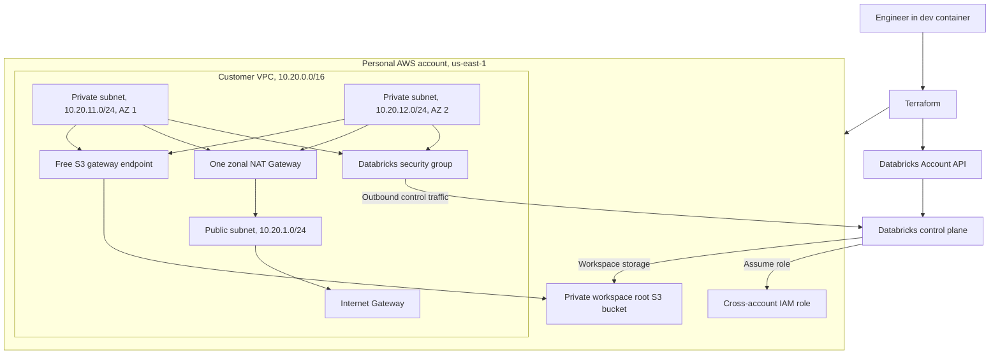

# Databricks Classic workspace on AWS with Terraform

This portfolio learning project provisions a Databricks Classic workspace in a
Terraform-managed customer VPC. It focuses on the AWS and Databricks account
infrastructure required for future Classic Compute without launching any
compute.

The current implementation supports `dev` only. The `qa` and `prod` directories
are placeholders in the project plan and do not contain deployable Terraform.

> Cost warning: the development stack creates one NAT Gateway and one public
> IPv4 address. They incur hourly charges even when no Databricks cluster is
> running. Never run `terraform apply` without reviewing the current price,
> account, region, plan, and cleanup schedule.

## Architecture



The public subnet hosts only the NAT Gateway. Future Classic Compute network
interfaces belong in the two private subnets. They do not receive public IPv4
addresses or accept public ingress. The two subnets are in different
Availability Zones because Databricks requires at least two workspace subnets
in distinct zones.

The lab uses one zonal NAT Gateway to limit cost. This is not highly available.
Traffic from the private subnet in the other zone can also incur cross-zone data
transfer charges if compute is launched there. No compute is created by this
project.

## What Terraform creates

AWS resources:

- One VPC with DNS support and DNS hostnames enabled
- One public subnet and two private subnets
- One Internet Gateway
- One zonal NAT Gateway and one Elastic IP address
- Public and private route tables and their associations
- One Databricks-compatible security group
- One S3 gateway VPC endpoint, which has no hourly endpoint charge
- One private, encrypted S3 workspace root bucket
- One cross-account IAM role with the provider-generated customer VPC policy

Databricks account resources:

- `databricks_mws_credentials`
- `databricks_mws_storage_configurations`
- `databricks_mws_networks`
- `databricks_mws_workspaces`

The configuration contains no `databricks_cluster`, EC2 instance, SQL warehouse,
job, load balancer, paid interface endpoint, or PrivateLink resource.

## Repository layout

```text
.
├── .devcontainer/
├── diagrams/
│   └── architecture.md
├── docs/
│   ├── README.md
│   ├── architecture.md
│   ├── cleanup.md
│   ├── cost-estimation.md
│   ├── deployment.md
│   └── networking.md
├── infrastructure/
│   ├── bootstrap/
│   ├── environments/
│   │   ├── dev/
│   │   ├── qa/              # Future placeholder only
│   │   └── prod/            # Future placeholder only
│   └── modules/
│       ├── databricks-workspace/
│       ├── iam/
│       ├── networking/
│       ├── platform/
│       └── storage/
└── scripts/
    ├── check-cleanup.sh
    └── verify.sh
```

## Prerequisites

Confirm every item before deployment:

1. Docker Desktop and VS Code can open the committed dev container.
2. The AWS CLI can authenticate to the intended personal AWS account.
3. The AWS identity can manage VPC, EC2 networking, IAM, and S3 resources.
4. The account has available VPC, Elastic IP, and NAT Gateway quotas.
5. A Databricks account is linked to the AWS account or has another valid
   payment method.
6. The Databricks plan permits Classic workspace creation.
7. The user or service principal is a Databricks account admin.
8. The Databricks account ID is known.
9. OAuth machine-to-machine credentials are available for the Databricks
   account service principal.
10. The AWS STS endpoint is active for `us-west-2`, as required by the current
    Databricks manual workspace setup documentation.
11. `10.20.0.0/16` does not overlap any network this lab must reach.

Databricks Free Edition alone is not sufficient for this Classic workspace
deployment. Verify trial, pay-as-you-go, or contract access before applying.

## Authentication model

Four identities have different purposes:

| Identity | Purpose |
| --- | --- |
| Local AWS identity | Terraform creates and destroys AWS resources. |
| Databricks account service principal | Terraform calls Databricks account APIs. |
| Cross-account IAM role | Databricks manages future Classic Compute resources in this VPC. |
| Future compute role | A separate optional role would grant workloads access to data. It is not created here. |

Configure AWS authentication with IAM Identity Center when available:

```bash
aws configure sso
aws sso login --profile <profile-name>
aws sts get-caller-identity --profile <profile-name>
```

Configure Databricks OAuth without placing the secret in Terraform files:

```bash
export DATABRICKS_HOST="https://accounts.cloud.databricks.com"
export DATABRICKS_ACCOUNT_ID="<account-id>"
export DATABRICKS_CLIENT_ID="<service-principal-client-id>"
export DATABRICKS_CLIENT_SECRET="<service-principal-secret>"

databricks auth describe
```

For interactive local administration, the container also persists a Databricks
configuration directory across rebuilds:

```bash
databricks auth login --host https://accounts.cloud.databricks.com \
  --profile account-admin
```

The client secret is read through Databricks unified authentication. It is not a
Terraform variable and must never be committed.

## Cost estimate for 72 hours

Reviewed on 2026-10-11. Recheck prices before deployment.

| Item | Example rate | 72-hour estimate |
| --- | ---: | ---: |
| One NAT Gateway | $0.045 per hour | $3.24 |
| One public IPv4 address | $0.005 per hour | $0.36 |
| Fixed AWS networking subtotal | | $3.60 |

Additional usage-based charges can include NAT data processing, cross-zone data
transfer, internet data transfer, S3 storage and requests, and Databricks usage
under the linked plan. With no cluster or warehouse and little data transfer,
the AWS infrastructure should reasonably remain under the `$10` target for 72
hours. This is an estimate, not a guarantee.

Do not deploy `qa` or `prod` at the same time. Each complete environment would
add another NAT Gateway and public IPv4 address.

Create AWS Budget alerts before deployment. Budget alerts notify you after an
actual or forecast threshold is reached. They are not hard spending limits.
See [cost estimation](docs/cost-estimation.md).

## Safe workflow

The current task stops before apply. To prepare the code:

```bash
cp infrastructure/bootstrap/terraform.tfvars.example \
  infrastructure/bootstrap/terraform.tfvars

cp infrastructure/environments/dev/terraform.tfvars.example \
  infrastructure/environments/dev/terraform.tfvars

terraform fmt -recursive -check infrastructure
terraform -chdir=infrastructure/bootstrap init -backend=false
terraform -chdir=infrastructure/bootstrap validate
terraform -chdir=infrastructure/environments/dev init -backend=false
terraform -chdir=infrastructure/environments/dev validate
```

Remote state bootstrap and development deployment are separate approval steps.
Read [deployment.md](docs/deployment.md) before running either apply.

Never apply a saved plan after changing its code, variables, provider lock file,
credentials, account, or region.

## Verification

After an explicitly approved deployment:

```bash
scripts/verify.sh
```

The script checks exact Terraform outputs for networking, NAT, security-group
rules, S3, IAM, and workspace status. It does not launch compute. To check that
no clusters exist, authenticate a separate workspace profile and set:

```bash
export DATABRICKS_WORKSPACE_PROFILE="<workspace-profile>"
scripts/verify.sh
```

## Cleanup

Capture exact IDs before destroy:

```bash
scripts/verify.sh
```

Then review and run the development destroy only after explicit approval:

```bash
terraform -chdir=infrastructure/environments/dev plan -destroy \
  -out=destroy.tfplan
terraform -chdir=infrastructure/environments/dev apply destroy.tfplan
scripts/check-cleanup.sh
```

Destroy the bootstrap state bucket only after the development stack is gone and
cleanup checks pass. See [cleanup.md](docs/cleanup.md) for the full order and the
S3 state implications.

## Learning outcomes

This project demonstrates how to:

- Build a Databricks-compatible customer VPC
- Separate public NAT infrastructure from private compute subnets
- Use an AWS cross-account role with an external ID
- Register AWS network, storage, and IAM objects with Databricks
- Provision a Classic workspace with account-level Terraform resources
- Isolate remote state and perform evidence-based cleanup
- Balance a learning architecture against personal-account cost constraints

This is a cost-conscious lab, not a production-ready high-availability design.

## Official references

- [Databricks customer-managed VPC requirements](https://docs.databricks.com/aws/en/security/network/classic/customer-managed-vpc)
- [Databricks manual workspace creation](https://docs.databricks.com/aws/en/admin/workspace/create-uc-workspace)
- [Databricks Terraform provider](https://registry.terraform.io/providers/databricks/databricks/latest/docs)
- [Databricks OAuth M2M authentication](https://docs.databricks.com/aws/en/dev-tools/auth/oauth-m2m)
- [AWS VPC pricing](https://aws.amazon.com/vpc/pricing/)
- [Terraform S3 backend](https://developer.hashicorp.com/terraform/language/backend/s3)
