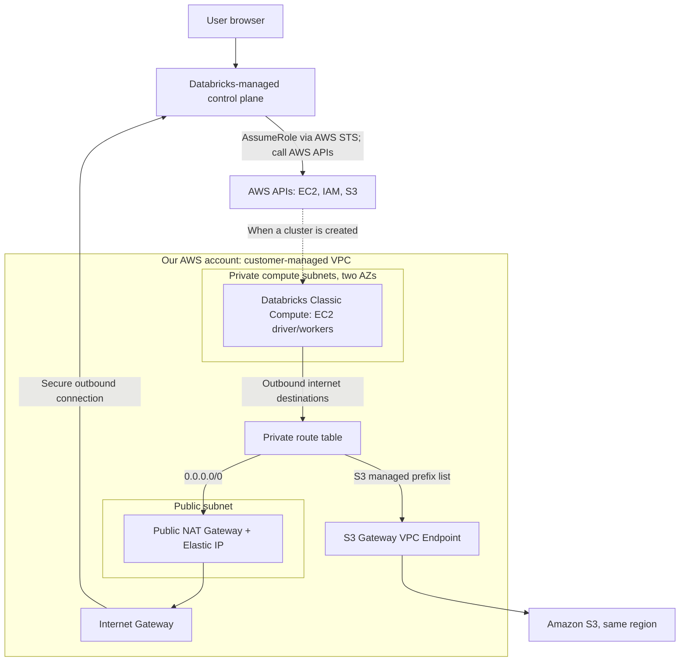

# Why We Use a NAT Gateway for Databricks on AWS

> **Project:** `databricks-aws-terraform`
>
> **Architecture:** Databricks Classic Compute, customer-managed VPC, private subnets, one public NAT Gateway, and an S3 Gateway Endpoint
> **Scope:** Networking explanation for our Terraform learning lab. No clusters are launched in the current lab.

## The short answer

**Databricks Classic Compute runs on EC2 instances in our private subnets. A public NAT Gateway lets those instances initiate outbound IPv4 connections to the Databricks control plane and other public endpoints without giving the EC2 instances public IPv4 addresses.**

The NAT Gateway is **not** how Databricks gets permission to create AWS resources. For that, the Databricks-managed control plane uses **AWS APIs**, **IAM roles**, and **AWS Security Token Service (STS)**.

## Architecture



*The EC2 node in this diagram is a **future runtime component**. It does not exist until a Classic cluster is started.*

## Three separate communication flows

### 1. Databricks control plane → AWS APIs (authorization and provisioning)

When a user requests a Classic cluster:

```text
User → Databricks control plane
     → AWS STS AssumeRole (cross-account IAM role)
     → Temporary AWS credentials
     → AWS EC2 APIs
     → EC2 instances launched in our private subnet(s)
```

- **IAM** determines what Databricks can do in our AWS account.
- **STS** issues temporary credentials after an authorized `AssumeRole` request.
- **AWS APIs** perform the provisioning.
- **Our VPC's NAT Gateway is NOT involved in these control-plane-to-AWS API calls.**

### 2. Databricks compute → Databricks control plane (networking)

After a Classic cluster starts, its EC2 nodes need outbound connectivity for cluster management and platform services:

```text
EC2 in private subnet
  → Private route table (0.0.0.0/0)
  → Public NAT Gateway (in a public subnet)
  → Internet Gateway
  → Databricks control-plane endpoints
```

Databricks **Secure Cluster Connectivity (SCC)** uses an outbound secure connection; we do **not** need to assign public IPv4 addresses or expose inbound internet access on our cluster nodes.

Other outbound destinations may include external APIs, libraries/package repositories, and AWS service endpoints for which we have not configured private endpoints. Required security group rules and destinations must follow the Databricks documentation.

### 3. Databricks compute → Amazon S3 (storage)

For **same-region S3 traffic**, our S3 Gateway Endpoint provides a more direct route:

```text
EC2 in private subnet
  → Private route table (S3 prefix-list route)
  → S3 Gateway Endpoint
  → Amazon S3
```

This **does not traverse the NAT Gateway**. The S3 Gateway Endpoint has **no additional endpoint hourly or data-processing charge**. S3 storage and request charges still apply.

The endpoint provides network routing; **IAM, endpoint policies, and S3 bucket policies** still govern access. A gateway endpoint is regional, so do not assume it handles cross-region S3 traffic.

## Why are a public subnet, Internet Gateway, and Elastic IP needed?

In **our zonal public NAT Gateway design**:

| Component | Job |
|---|---|
| Private subnet | Hosts Databricks Classic EC2 nodes; no public IPs needed |
| Private route table | Sends default outbound IPv4 traffic to the NAT Gateway |
| Public subnet | Hosts the NAT Gateway; its route table points to an Internet Gateway |
| Public NAT Gateway | Translates outbound connections from private IPv4 addresses |
| Elastic IP | Public IPv4 address associated with the NAT Gateway |
| Internet Gateway | Connects the VPC to internet destinations |
| S3 Gateway Endpoint | Handles supported same-region S3 traffic without using NAT |

**A subnet is public because of its route to an Internet Gateway, not because every resource in it automatically has a public IP.** We do not enable automatic public IPv4 assignment for our private compute subnets.

## Example route tables

**Public subnet route table**

| Destination | Target |
|---|---|
| `10.20.0.0/16` | `local` |
| `0.0.0.0/0` | Internet Gateway (`igw-...`) |

**Private compute subnet route table**

| Destination | Target |
|---|---|
| `10.20.0.0/16` | `local` |
| `0.0.0.0/0` | NAT Gateway (`nat-...`) |
| AWS-managed S3 prefix list (`pl-...`) | S3 Gateway Endpoint (`vpce-...`) |

The S3-specific prefix-list route takes precedence over the default `0.0.0.0/0` route for matching S3 destinations. AWS adds that route when we associate the private route table with the gateway endpoint.

## Do we always need a NAT Gateway for Databricks?

**No. NAT is part of this conventional public-egress architecture, not a universal Databricks requirement.** A more restrictive design can use Databricks **back-end AWS PrivateLink** plus the necessary AWS VPC endpoints and routes to eliminate public NAT/IGW egress for compute. That architecture needs more configuration, applicable account features, and careful planning for every required destination.

For our lab, **private subnets + one public NAT Gateway + S3 Gateway Endpoint** is easier to understand and deploy.

## Cost and availability trade-offs

Our lab uses **one NAT Gateway** to minimize cost. That is acceptable for a temporary learning environment but creates a single-AZ dependency; traffic from the other AZ can also incur cross-AZ charges.

For a more resilient zonal NAT design, production environments often use **one NAT Gateway per AZ**, with private subnets routed through the gateway in their own AZ. Final design depends on security, availability, and cost requirements.

Illustrative `us-east-1` rates (verify current prices before deployment):

- NAT Gateway: approximately **$0.045/hour** while available, **plus data processing**.
- Elastic IP/public IPv4 attached to it: approximately **$0.005/hour**.
- Combined idle baseline for one NAT + one EIP: approximately **$0.05/hour**, or **$3.60 for 72 hours**, excluding traffic and other AWS/Databricks charges.
- S3 Gateway Endpoint: **no additional endpoint charge**.

**Very important for our $10 lab:** Even when **no Databricks clusters are running**, the NAT Gateway and its allocated public IPv4 address can continue to incur hourly charges. We should destroy the environment as soon as testing is complete and verify that the NAT Gateway and Elastic IP are gone.

## How this maps to Terraform

Terraform creates and connects the network resources with resources such as:

- `aws_vpc`, `aws_subnet`, `aws_internet_gateway`
- `aws_eip`, `aws_nat_gateway`
- `aws_route_table`, `aws_route_table_association`, `aws_route`
- `aws_vpc_endpoint` with `vpc_endpoint_type = "Gateway"` for S3
- `aws_security_group` and required rules

Databricks account-level Terraform resources register the customer-managed VPC, AWS credentials, and root storage, and provision the workspace. **Creating the workspace alone does not mean that Classic EC2 instances are running.**

## The takeaway

> **IAM + STS + AWS APIs** let the Databricks control plane **provision and manage** AWS resources.
>
> **Private subnet + NAT Gateway + Internet Gateway** let the **running Classic Compute instances** make outbound internet connections without public IPs.
>
> **S3 Gateway Endpoint** lets those compute instances reach **same-region S3** without routing that traffic through NAT.

## Official references

1. [Databricks: Configure a customer-managed VPC](https://docs.databricks.com/aws/en/security/network/classic/customer-managed-vpc)
2. [Databricks: Classic compute plane networking and Secure Cluster Connectivity](https://docs.databricks.com/aws/en/security/network/classic)
3. [Databricks: Configure classic private connectivity and PrivateLink](https://docs.databricks.com/aws/en/security/network/classic/privatelink)
4. [AWS: NAT gateways](https://docs.aws.amazon.com/vpc/latest/userguide/vpc-nat-gateway.html)
5. [AWS: Gateway endpoints for Amazon S3](https://docs.aws.amazon.com/vpc/latest/privatelink/vpc-endpoints-s3.html)
6. [AWS: NAT Gateway pricing](https://docs.aws.amazon.com/vpc/latest/userguide/nat-gateway-pricing.html)
7. [AWS: Public IPv4 pricing context](https://aws.amazon.com/blogs/networking-and-content-delivery/identify-and-optimize-public-ipv4-address-usage-on-aws/)
